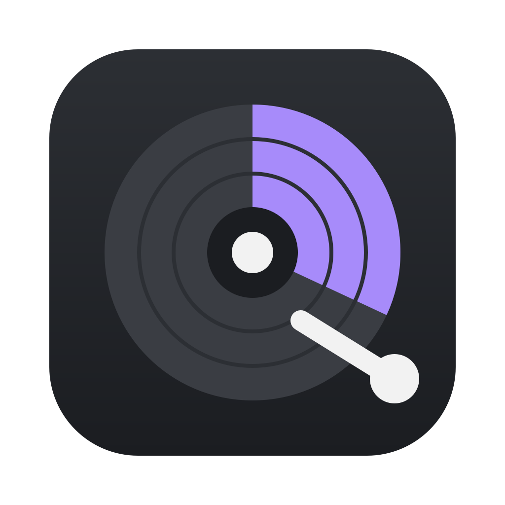

<p align="center"></p>

# hdCLEANER

[](https://openmacapps.com/apps/hdcleaner/) [](https://github.com/starbudweiser/hdCLEANER/releases/latest) [](LICENSE)

A macOS disk cleaner: it scans the usual places for junk, shows what each category would free, and removes what you tick.

🇬🇧 English · 🇫🇷 [Français](#français)

## About

hdCLEANER is a personal take on AppYogi's *Disk Cleaner* — not affiliated with its authors. Made by Starbudweiser & Claude Code (Anthropic), MIT License, © 2026 Starbudweiser. Provided as is, without warranty. The app's own *About hdCLEANER* entry is in the application menu.

## Features

- **19 categories** with their size: app caches, app logs, browser caches (never history, cookies or passwords), developer caches (Xcode, Homebrew, npm, pip…), Trash, Downloads, Mail attachments, large files, uninstalled app leftovers (including orphaned containers and group containers), iPhone/iPad backups, iOS photo cache, Music cache, iOS updates, installer packages and macOS installers, screenshots — and, with your administrator password, **system caches**, **system logs** (archived `/var/log`, crash reports), **local Time Machine snapshots** and **unused app languages**.
- **Applications tab**: pick an app, see the files it left in your Library (preferences, caches, containers, launch agents…), and move the app and what you tick to the Trash.
- **Maintenance tab**: DNS cache flush, Spotlight reindex, Launch Services rebuild, periodic system scripts, home-folder permission repair (`diskutil resetUserPermissions`) and startup-disk verification, with a live log. The ones that need it ask for your administrator password.
- **Permissions tab**: *Repair access* (default) fixes a folder or a whole volume and everything in it when copies or moves leave files you cannot delete, move or edit (wrong owner, padlock, missing rights): you become the owner, locks and ACLs are removed, you get read/write on files and full access to folders; other users' rights and file contents are untouched. "Scan for problems" shows what blocks before anything changes, and the result is re-checked afterwards; items owned by someone else offer a retry with the administrator password. *Advanced* gives the full toolbox: BSD flags (`chflags`: hidden, locked/uchg, nodump, opaque, append-only, or clear all), permissions (`chmod`, octal or symbolic, separately for files and folders), owner (`chown`), ACLs, quarantine and extended attributes, with scope (all / files / folders) and a preview. System folders and the startup volume root are refused, a folder mode that would make folders unreadable is refused, and recursion never crosses into another volume.
- **Hidden files tab**: scan a folder or volume for macOS invisible files (`.DS_Store`, AppleDouble `._*`, `__MACOSX`, `.TemporaryItems`, volume system folders such as `.Spotlight-V100`, `.fseventsd`, `.Trashes`) and delete them. Custom icons are kept (`Icon` files, and `._` files whose Finder info flags a custom icon). **Watch** folders or volumes so new `.DS_Store`, `._*` and `__MACOSX` are removed the moment they appear (while hdCLEANER runs in the menu bar).
- **Security tab**: an antivirus built on [YARA](https://github.com/VirusTotal/yara) (BSD, bundled) fed with Apple's own **XProtect** malware rules (512 rules, updated by macOS; a button forces the update) plus hdCLEANER rules for suspicious startup items. *Quick scan* checks startup folders, Applications and Downloads; *Scan a folder…* checks any folder. **Real-time protection** (on/off switch in the tab and in Settings) watches `LaunchAgents`/`LaunchDaemons` through file-system events — no CPU while nothing changes — and quarantines a suspicious file as soon as it appears, with a notification. Quarantined items can be restored or deleted.
- **Safe by design**: only regenerable data that needs no password is ticked after a scan; personal files (Downloads, large files, installers, screenshots, backups, leftovers) and every system item are never ticked. Personal files go to the Trash. A last check refuses anything outside the expected places (your home folder, `/Library/Caches`, `/Library/Logs`, `/var/log`, installer apps and `.lproj` folders of third-party apps). Items of a running app are flagged. Language removal skips Apple and App Store apps and never removes the system languages or English.
- **Administrator password** asked once per cleaning, only when system items are ticked (standard macOS dialog).
- **Exclusions**: right-click a row to stop suggesting it.
- **Threshold monitor**: a notification when free space drops below a percentage, a menu bar icon that stays after the window is closed, optional start at login.
- The window remembers its size and opens centered. Socle animated splash at launch (4 s, window opens at 2 s; fixed image with "Reduce motion"), with an animated hard-disk icon, and a faint hard-disk platter watermark behind the machine column.
- Dark, light or system theme; French, English, Spanish and Italian (follows the system language, English otherwise).

Some folders (Mail, Safari, Containers…) need *Full Disk Access*; the app says so on the category instead of showing an empty list.

## Install

**[Download the latest notarized release](https://github.com/starbudweiser/hdCLEANER/releases/latest)**, unzip it and move **hdCLEANER.app** to your Applications folder. Requires **macOS 14 Sonoma** or later.

### Updates

The app checks GitHub once a day for a new release and shows what changed before anything is installed. "Check for updates…" (app menu, menu bar icon, Settings > Updates) checks on demand; "Install" downloads the notarized package, verifies its SHA-256 and signature, replaces the app and relaunches it.

## Build

```bash
swift test        # unit tests
./build.sh        # builds, signs and installs hdCLEANER.app
```

`build.sh` signs through a helper script specific to the author's machine; edit `SIGN_TOOL` (or use `SIGN_IDENTITY="<certificate name>" ./build.sh`).

- `Sources/HdCleanerCore` — logic with no UI: scanner, safety guard, cleaner, threshold. Unit-tested.
- `Sources/hdCLEANER` — AppKit/SwiftUI app.
- `Resources/*.lproj`, `tools/strings_table.py` — texts in four languages (`python3 tools/gen_strings.py`).

## Languages

English, French, Spanish and Italian. The app follows your Mac's preferred language automatically (English if it is none of these four).

## Support

Bug reports and suggestions: [GitHub Issues](https://github.com/starbudweiser/hdCLEANER/issues).

## License

Released under the **MIT License**, © 2026 Starbudweiser. See [LICENSE](LICENSE).

---

## Français

Nettoyeur de disque pour macOS : il analyse les emplacements habituels des fichiers inutiles, montre ce que chaque catégorie libérerait et supprime ce que vous cochez.

- 19 catégories (caches, journaux, Corbeille, téléchargements, restes d'applis désinstallées, sauvegardes iPhone… et, avec le mot de passe administrateur, caches et journaux système, instantanés Time Machine locaux, langues inutilisées).
- Onglets Applications, Maintenance, Autorisations, Fichiers cachés et Sécurité (antivirus YARA alimenté par les règles XProtect d'Apple, protection en temps réel).
- Sûr par conception : seules les données régénérables sans mot de passe sont cochées après une analyse ; les fichiers personnels vont à la Corbeille.
- Inspiré de *Disk Cleaner* d'AppYogi, sans lien avec ses auteurs.

Installation : téléchargez la [dernière version notarisée](https://github.com/starbudweiser/hdCLEANER/releases/latest), décompressez-la et placez **hdCLEANER.app** dans Applications (macOS 14 Sonoma ou plus récent).

Interface en français, anglais, espagnol et italien, choisie d'après la langue du Mac (anglais sinon). Licence MIT, © 2026 Starbudweiser. Questions et bugs : [Issues GitHub](https://github.com/starbudweiser/hdCLEANER/issues).
